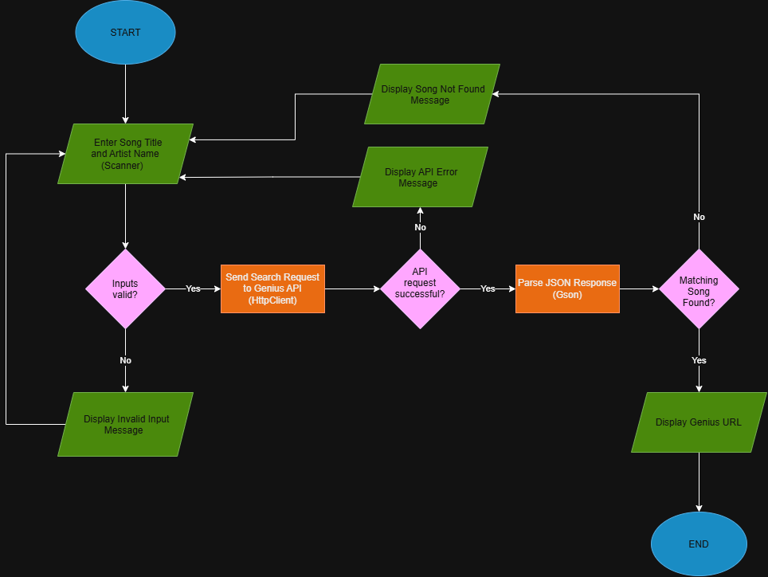

# LyricLink
Java program that links Genius lyrics to a song.

## The Problem
I love listening to music, and I always try to understand what the artist is trying to communicate. Whenever there are deeper lyrics or parts I can't hear very well, I have to manually open a browser, search for the song, and find the right page I want. This takes time for being somewhat simple and repetitive task, and it could be simplified and automated.

## How It Works
I want to build a Java program that lets a user enter a song title and artist name and provides a direct link to the lyrics on Genius. It should:
- Accept song title and artist input
- Search for songs using the Genius API
- Identify the matching song and display its URL
- Handle invalid inputs and unsuccessful searches

## Tech Stack
- Language: Java
- Libraries: Scanner, HttpClient, Gson
- External Tools: Genius API, Git & GitHub, VSCode
- Environment: WSL Ubuntu Terminal

## Setup
Installation instructions will be added during development of the program.

## Usage
User enters a song title and artist name and is provided with the Genius link to the lyrics.
Examples will be provided after program is runnable.

## Roadmap
[ ] Save a search history
[ ] Automatically open URL
[ ] Give multiple results
[ ] Account for spelling mistakes
[ ] Option to search again

## Author
Owen Minnich, https://github.com/omminnich
