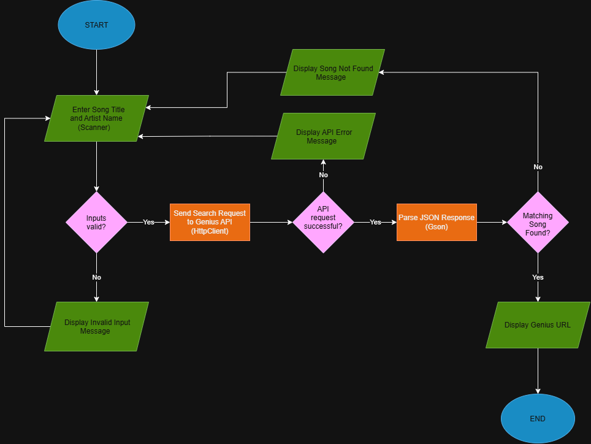

# LyricLink
Java program that links Genius lyrics to a song.

## The Problem
I love listening to music, and I always try to understand what the artist is trying to communicate. Whenever there are deeper lyrics or parts I can't hear very well, I have to manually open a browser, search for the song, and find the right page I want. This takes time for being a somewhat simple and repetitive task, and it could be simplified and automated.

## How It Works
LyricLink is a Java program that lets a user enter a song title and artist name and provides a direct link to the lyrics on Genius. The program:
- Accepts song title and artist input
- Searches for songs using the Genius API
- Uses Gson to parse the JSON response
- Identifies the matching song and displays its URL
- Handles invalid inputs and unsuccessful searches



## Tech Stack
- Language: Java
- Libraries: Scanner, HttpClient, Gson
- External Tools: Genius API, Git & GitHub, VSCode
- Environment: WSL Ubuntu Terminal
- Data Storage: None (LyricLink does not store user data)

## Setup
* Requirements: Java, Git, and Gson.
* Setup instructions are intended for WSL Ubuntu. Program may run but use different commands with other operating systems.

### 1. Clone the Repository
Open a WSL Ubuntu terminal and run:

```bash
git clone https://github.com/omminnich/LyricLink.git
cd LyricLink
```

### 2. Install Java and Gson
LyricLink requires Java 11 or newer and the Gson library.
Install them using:

```bash
sudo apt install default-jdk libgoogle-gson-java
```

### 3. Set Up Genius API Token
LyricLink requires a Genius Client Access Token to search for songs.

1. Go to https://genius.com/api-clients and create a Genius API client to get an access token.
2. In your terminal, run:

```bash
read -rsp "Genius Access Token: " GENIUS_ACCESS_TOKEN
echo
export GENIUS_ACCESS_TOKEN
```

3. Paste your access token when prompted and press Enter.

Your token is stored in the current session and will have to be set again when opening a new session.

### 4. Compile and Run LyricLink
After everything is installed and set up, compile the program:

```bash
javac -cp /usr/share/java/gson.jar src/LyricLink.java
```

and run the program:

```bash
java -cp "src:/usr/share/java/gson.jar" LyricLink
```

## Usage
User enters a song title and artist name and is provided with the Genius link to the lyrics.

```text
Enter song title:
radiolove
Enter artist name:
riovaz
Searching for "radiolove" by riovaz...
Song: radiolove
Artist: Riovaz
Genius Lyrics: https://genius.com/Riovaz-radiolove-lyrics
```

```text
Enter song title:
constantly
Enter artist name:
tiffany day
Searching for "constantly" by tiffany day...
Song: CONSTANTLY
Artist: Tiffany Day & slayr
Genius Lyrics: https://genius.com/Tiffany-day-and-slayr-constantly-lyrics
```

## Roadmap

### Completed MVP
- [x] Set up Java project and GitHub repository
- [x] Implement Scanner for user input
- [x] Connect to Genius API using HttpClient
- [x] Parse JSON responses using Gson
- [x] Match song titles and artists
- [x] Extract and display Genius lyrics URLs
- [x] Handle invalid inputs and failed searches

### Future Features
- [ ] Save a search history
- [ ] Automatically open URL
- [ ] Give multiple results
- [ ] Account for spelling mistakes
- [ ] Option to search again

## Demo
Video walkthrough soon.

## Author
Owen Minnich, https://github.com/omminnich
